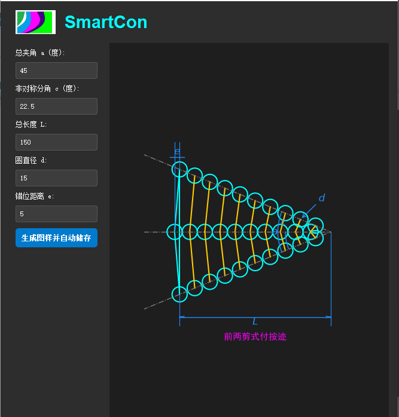
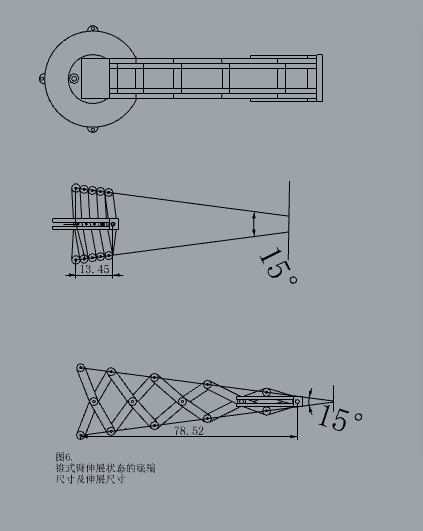
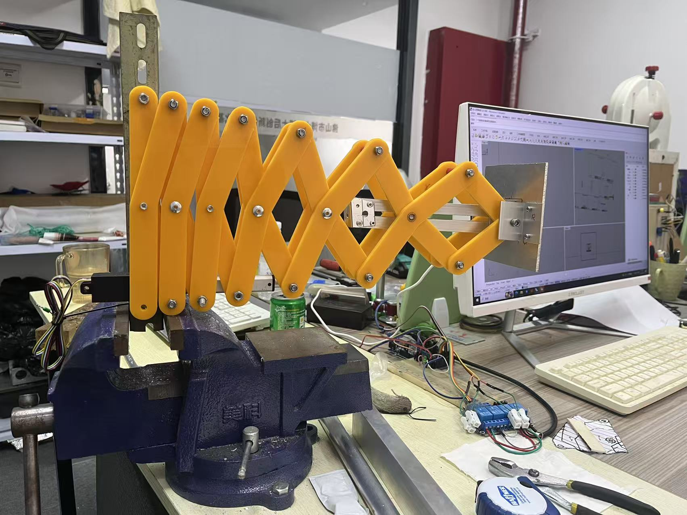
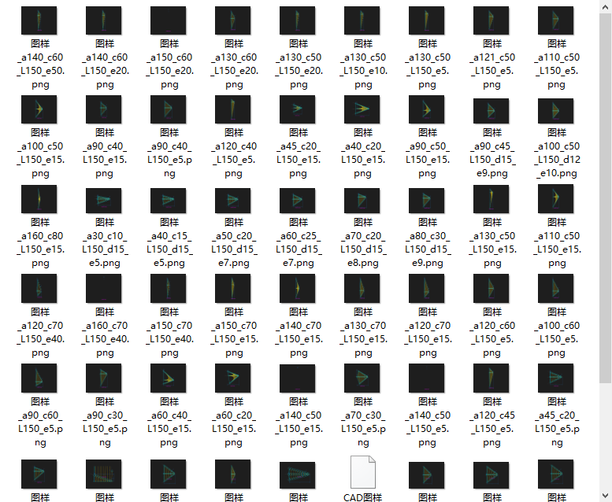
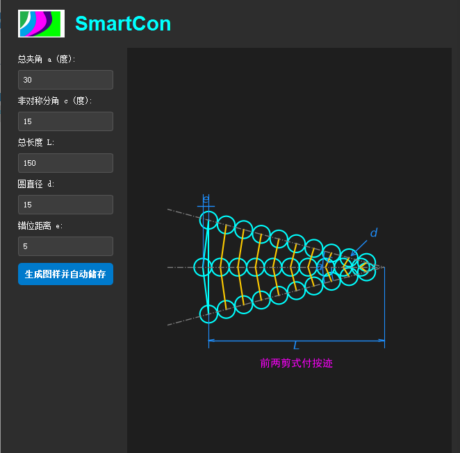
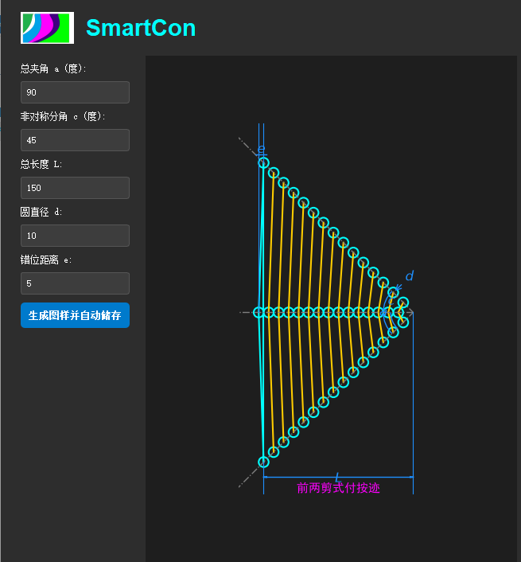
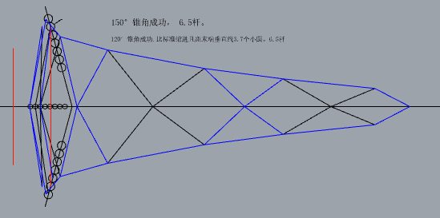
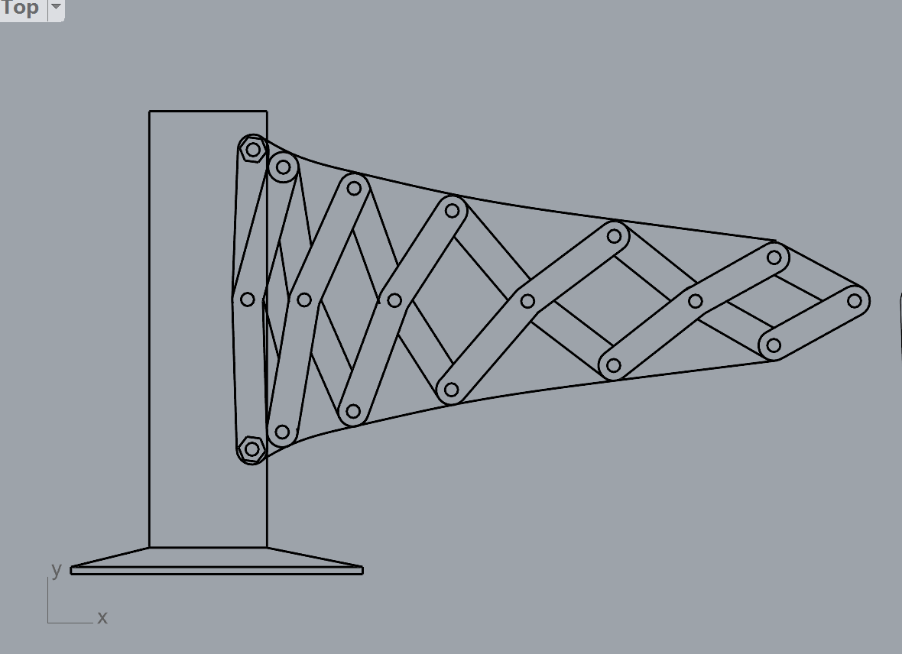
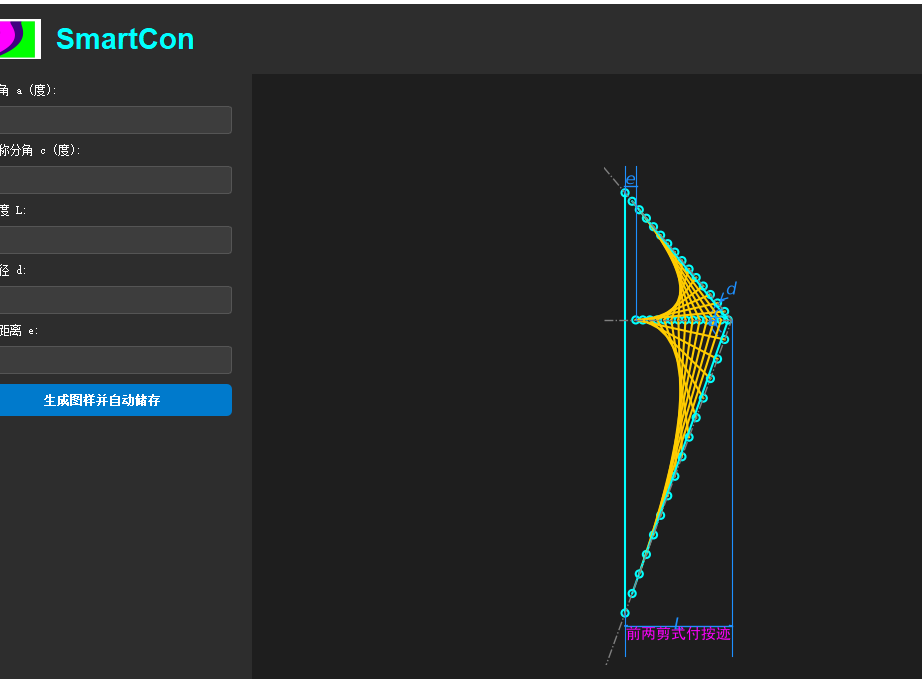

 
SmartCon and a New Frontier in Engineering Structures space

**David Tang**  
**October 15, 2026**

Over the past several years, artificial intelligence has made remarkable progress across the fundamental sciences. From protein-structure prediction to computational discovery in mathematics, physics, and chemistry, AI is evolving from an analytical tool into a new instrument for exploring vast spaces of possibilities.

This raises an important question for engineering:

**If AI can explore proteins, molecules, and mathematical structures, can it also explore the physical structures of machines? **

In other words, the next frontier of AI may extend beyond software, algorithms, and foundation models into the machines themselves—their mechanisms, topology, load paths, motion patterns, and ultimately the **Physical Architecture of AI** that connects intelligence to the physical world.

This is the motivation behind our development of **SmartCon**.

## From Conventional Scissor Mechanisms to Nonlinear Scissor Architectures

Scissor mechanisms have existed for more than a century.

Conventional scissor mechanisms provide simple construction and large extension ratios, but they also have an inherent geometric limitation: as the mechanism extends, the distance between its base supports changes. Near full extension, the geometry can become increasingly unfavorable for transverse loading.

For more than two decades, our research has centered on a different question:

**Can we construct a nonlinear scissor mechanism that preserves a predefined overall geometric boundary throughout a large extension range while keeping its base mounting locations stable?**

Through topological structural design, we developed a family of nonlinear scissor mechanisms and subsequently parameterized and digitized these structures into SmartCon.

The physical prototype shown in Figure 1 represents one example.

During extension, its base mounting locations can remain fixed while the mechanism expands within a predefined conical domain, providing a different structural approach for long-reach robotic arms. 

**[Figure 1: Physical prototype of a nonlinear scissor robotic arm]**

## Why Does This Matter for Robotics?

For decades, industrial robots have largely been built around a familiar architecture:

**rotary joints + rigid links + precision gear reducers.**

This architecture is mature and highly successful. However, as robots are required to achieve longer reach, lower mass, lower energy consumption, and larger workspaces, its structural tradeoffs become increasingly significant.

Our nonlinear scissor robot experiments are exploring another path.

Current research and prototype results suggest the potential to reduce—or in certain joints eliminate—the dependence on precision reducers, lower drive power and structural mass, extend robotic reach and workspace, simplify portions of the kinematic formulation, and create new body architectures optimized for long-stroke and lightweight robotic applications.

One of our ultra-long-reach prototypes has already achieved a reach of **3.5 meters**, and we are exploring substantially larger scales.

But the significance is not simply about building a longer robot arm.

The deeper question is:

> **Can we redesign the physical body of the robot instead of continuously adding larger motors, heavier reducers, and more complex control algorithms to architectures established decades ago?**

---

# SmartCon: From Designing One Structure to Exploring a Structural Space

The major change comes when AI and parametric generation enter the process.

Traditionally, an engineer might spend weeks or months designing and validating a single mechanism.

But when a mechanism is governed by multiple parameters, each with many possible values, the number of combinations quickly exceeds what engineers can manually examine.

The question then changes.

Instead of asking:

**“Can an engineer design a good mechanism?”**

we can begin asking:

**“Can AI help engineers search an entire structural space and discover mechanisms that we may never have considered?”**

That is the purpose of SmartCon.

# Fixed Cone Angles

One early family of our nonlinear scissor arms has an important characteristic:

**the cone angle remains fixed.**

For example, a robotic arm designed with a 15° cone angle maintains its overall 15° geometric envelope throughout extension and retraction.

Likewise, structures can be designed for 20°, 30°, 45°, or other angles.

SmartCon can automatically generate corresponding structures from these parameters.

**[Figure 2: Fixed-cone-angle structure generated by SmartCon]**

This seemingly simple property changes a fundamental geometric characteristic of conventional scissor mechanisms, whose external envelope normally changes continuously during extension. 

---

# The First Surprise from AI: Variable Cone-Angle Arms

Something more interesting happened when we expanded SmartCon's parameter-search range.

Engineers naturally tend to restrict designs to ranges that experience tells us are “reasonable”—for example, cone angles between 15° and 45°.

But a computer does not carry the same design habits.

So we asked:

**What happens at 90°?**

And then:

**What happens as we approach 180°?**

As SmartCon began generating combinations outside conventional engineering intuition, a new family of structures emerged.

We call them:

## Variable Cone-Angle Arms

Unlike fixed-cone-angle arms, these mechanisms can change their overall cone angle as they retract and extend.

A structure may have a large cone angle while retracted, reducing its footprint in certain directions, and then transform toward a smaller working cone angle as it extends.

More importantly, the cone angle can vary along the span.

For example:

**the cone angle can be smaller near the tip and progressively larger toward the base.**

This geometric distribution can potentially be optimized in relation to the changing bending moment along the arm, allowing structural geometry and material to participate more effectively in load carrying.

At this point, the problem is no longer simply about extending a robot arm.

It becomes a deeper engineering question:

> **Can the physical morphology of a robot be spatially distributed according to its mechanical loading requirements?**

This is the direction illustrated by Figure 4 in the original article. 

# The Second Surprise: Turning Motion from a Single Drive Axis

Another SmartCon-generated family produced an unexpected result.

A conventional single-axis extension mechanism is generally expected to generate approximately linear motion.

However, parameter exploration revealed that:

**with an asymmetric topology, a mechanism with only one primary drive input can generate significant turning motion at its endpoint.**

We call this family:
## Asymmetric Turning Arms

SmartCon uses parameters such as an “asymmetric half-angle” to describe and generate these structures.

This could have important implications for industrial automation.

For example, a single-drive mechanism could potentially perform:

**extend → move around an obstacle → reach a workpiece**

without necessarily adding multiple conventional rotary joints.

In certain task-specific machines, this suggests that **mechanical topology itself can perform part of the motion function that would otherwise require additional actuators and controlled axes.** 

---

# From Design to Traversal

This is where AI becomes especially important.

For more than two decades, we relied heavily on engineering experience to identify a small number of useful structures within an enormous parameter space.

As the number of parameters grows, however, manual exploration becomes impractical.

Within the current SmartCon framework, expanding the search across broader parameter ranges can produce a candidate design space on the order of **10? configurations or more**. 

For human engineers, exhaustive exploration at this scale is unrealistic.

For AI and automated computational systems, however, it becomes a fundamentally different type of problem.

Robot design can therefore begin moving from:

**Design**

toward:

**Generate → Traverse → Evaluate → Optimize**

This may become one of AI's most profound contributions to engineering design.

---

# When SmartCon Generates Structures We Did Not Anticipate

As we continued expanding the parameter ranges, SmartCon began generating highly unusual geometries.

Some resemble bat wings, bird wings, or even certain flying-wing aircraft configurations.

**[Figure 7: Candidate structures generated through SmartCon parameter exploration]**

Could some of these structures eventually have applications in aerospace?

We do not yet know. But it looks beautiful, doesn't it?

A geometric pattern is not an engineering structure. Any such candidate would still require rigorous analysis of kinematics, structural mechanics, dynamics, materials, fatigue, manufacturability, and experimental validation.

But these results demonstrate something important:

**We are beginning to explore regions of mechanical design space that have not been systematically searched before.**

That, rather than the visual resemblance of any particular generated geometry, is the important result. 

# AI Should Not Only Control Robots. It Can Help Redesign Them.

Much of today's discussion around Physical AI focuses on foundation models, computer vision, reinforcement learning, world models, and humanoid robots.

All of these areas are important.

But one fundamental issue remains:

**AI ultimately interacts with the physical world through a physical body.**

If that body remains constrained by mechanical paradigms established decades ago, the capabilities of AI will ultimately remain constrained by those physical architectures.

We therefore believe that Physical AI has at least two deeply interconnected layers:

**Intelligence Architecture**

and

**Physical Architecture.**

SmartCon is our attempt to bring AI into the second layer.

Not only to let AI **control machines**, but increasingly to help us:

**discover machines, generate machines, optimize machines—and ultimately redesign the physical body of machines.**

This may be where the **Physical Architecture of AI** truly begins.
